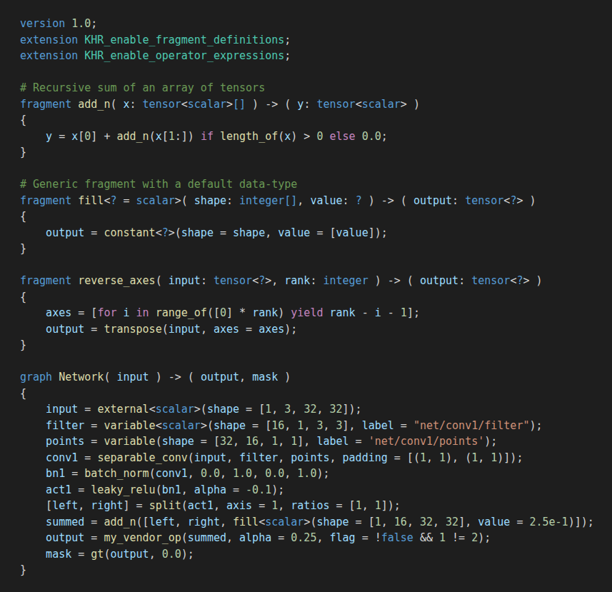

# NNEF Syntax Highlighting

Syntax highlighting, snippets and editor support for the [Khronos NNEF](https://www.khronos.org/nnef) (Neural Network Exchange Format) textual formats:

- **`.nnef`** graph descriptions (e.g. `graph.nnef`), covering both flat and compositional syntax
- **`graph.quant`** / **`.quant`** quantization files



## Features

- Highlighting based on the [NNEF 1.0.5 specification](https://registry.khronos.org/NNEF/specs/1.0/nnef-1.0.5.html) grammar:
  - `version` and `extension` declarations (`KHR_*`, `EXT_*`, vendor extensions)
  - `graph` and `fragment` definitions, including generic fragments (`fragment f<? = scalar>(...)`) and bodiless custom operation declarations
  - Types: `tensor<...>`, `integer`, `scalar`, `logical`, `string`, generic `?`, arrays `[]` and tuple types
  - All standard NNEF operations (`external`, `variable`, `conv`, `max_pool`, `matmul`, `softmax`, `batch_normalization`, quantization ops, …) are highlighted separately from custom fragment calls
  - Builtins `length_of`, `range_of`, `shape_of` and the cast functions `integer()`, `scalar()`, `logical()`, `string()`
  - Operator expressions, `if`/`else` and `for … in … yield` comprehensions
  - Named arguments, fragment parameters, numeric, string and logical literals, and `#` comments
- Quantization files: tensor-name keys, quantization algorithm calls and per-channel array literals
- Editor support: comment toggling (`Ctrl+/`), bracket matching, auto-closing pairs, auto-indent, and folding on `{ }` blocks and `# region` / `# endregion` markers
- Snippets: `version`, `extension`, `graph`, `fragment`, `fragment<?>`, `fragment;`, `variable`, `conv`, `for`

All scopes are standard TextMate scopes, so any colour theme works.

## Usage

Install the extension and open any `.nnef` or `graph.quant` file. To use NNEF highlighting for a file with a different name, add a mapping to your settings:

```json
"files.associations": {
  "*.nnef.txt": "nnef",
  "*.quant.txt": "nnef-quant"
}
```

## Contributing

Issues and pull requests are welcome at [github.com/Gursukh/nnef-syntax](https://github.com/Gursukh/nnef-syntax).

```sh
npm install
npm test          # run the grammar scope tests in test/
npm run package   # build a .vsix
```

To try changes, open this folder in VS Code and press `F5`, or run `code --extensionDevelopmentPath=.`, and then open a file from `samples/`.

## License

[MIT](LICENSE). NNEF is a trademark of The Khronos Group Inc. This extension is not affiliated with or endorsed by Khronos.
